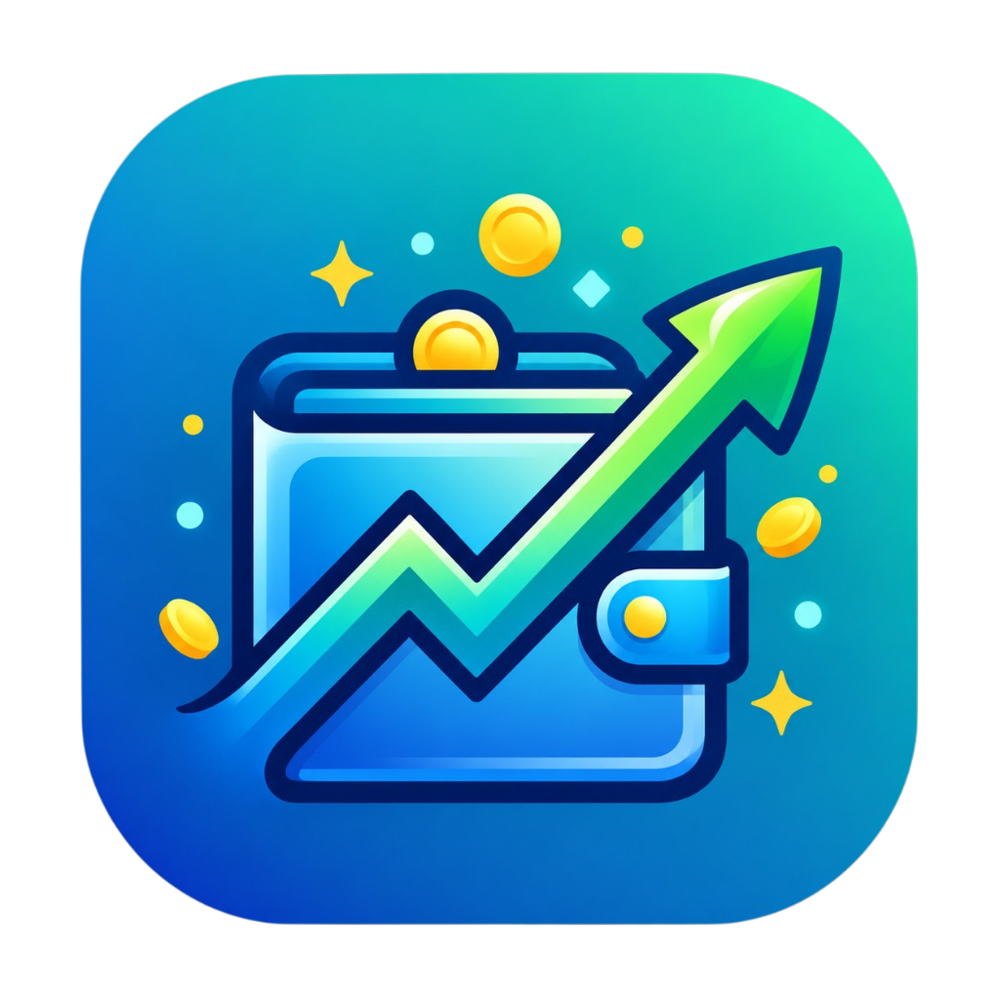

# 💰 My Money (Balance App)

<p align="center">
  
</p>

<p align="center">
  <b>Aplicación moderna de finanzas personales, control de gastos, gestión de deudas y detección inteligente de notificaciones bancarias.</b>
</p>

<p align="center">
  
  
  
  
  
</p>

---

## 📥 ¿Cómo Descargar e Instalar la App?

¡Puedes instalar la app directamente en tu teléfono Android sin complicaciones!

### Opción 1: Descarga Directa desde GitHub Releases (Recomendada)
1. Ve a la sección de **[Releases / Lanzamientos](https://github.com/JanerBus/Balance_app/releases)**.
2. Descarga el archivo **`app-release.apk`** de la versión más reciente.
3. Abre el archivo descargado en tu celular.
4. Si Android muestra una advertencia de seguridad:
   - Toca en **Configuración / Ajustes**.
   - Habilita la opción **"Permitir desde esta fuente"** (o "Instalar aplicaciones desconocidas").
   - Presiona **Instalar** (si Google Play Protect te avisa, toca en *"Instalar de todas formas"*).
5. ¡Listo! Abre **My Money** y empieza a gestionar tus finanzas.

---

## ✨ Características Principales

### 📊 1. Registro Ágil de Transacciones y Presupuestos
- Registra ingresos y gastos en segundos con categorías predefinidas o personalizadas.
- Filtra por fecha, categoría o cuenta.
- Asigna presupuestos mensuales para mantener tus gastos bajo control.

### 🏦 2. Gestión Multi-Cuenta y Divisas
- Soporte para múltiples cuentas (Efectivo, Cuentas Bancarias, Billeteras Digitales, Tarjetas).
- Carrusel interactivo para visualizar el saldo por cuenta y el patrimonio neto global.
- Selector multi-moneda (COP, USD, EUR, MXN, etc.).

### 🔔 3. Detección Inteligente de Notificaciones Bancarias (Android)
- Escucha automáticamente notificaciones de bancos y billeteras digitales (Bancolombia, Nequi, Daviplata, etc.).
- Sugiere registros inmediatos con monto, comercio y fecha pre-llenados mediante expresiones regulares configurables.
- Motor de reglas con aprendizaje continuo para clasificar automáticamente tus gastos futuros.

### 🎯 4. Metas de Ahorro y Objetivos
- Define metas financieras con montos objetivos y fechas límite.
- Registro visual de aportes periódicos y porcentaje de avance.

### 💳 5. Control de Deudas y Préstamos
- Controla tanto el dinero que debes como el dinero que te deben.
- Historial de abonos, saldos pendientes y estado de liquidación.

### 🔄 6. Transacciones Recurrentes
- Programa pagos automáticos para nóminas, suscripciones (Netflix, Spotify), servicios públicos o arriendos.

### 📈 7. Estadísticas y Reportes Visuales
- Gráficos interactivos de barras y pastel (`fl_chart`) para analizar tus hábitos de consumo.
- Comparativas mensuales y desglose por categorías.

### 📑 8. Exportación en PDF y CSV
- Genera extractos financieros detallados en formato **PDF** listos para imprimir o compartir.
- Exporta todas tus transacciones en formato **CSV** compatible con Excel y Google Sheets.

### 🔒 9. Máxima Privacidad y Seguridad Local
- **100% Offline**: Tus datos financieros te pertenecen exclusivamente a ti. Se almacenan de forma local mediante **SQLite**, sin sincronizaciones con servidores de terceros.
- Bloqueo biométrico con **Huella Digital / Face ID** o **código PIN de seguridad**.
- Bloqueo automático al salir de la aplicación.

---

## 🛠️ Stack Tecnológico

| Componente | Tecnología / Librería |
| :--- | :--- |
| **Framework** | Flutter (Dart 3) |
| **Arquitectura de Estado** | Provider |
| **Base de Datos** | SQLite (`sqflite` + `path`) |
| **Persistencia Ligera** | `shared_preferences` |
| **Gráficos** | `fl_chart` |
| **Seguridad** | `local_auth` (Biometría) + `crypto` (Hashing PIN) |
| **Documentos** | `pdf` + `printing` |
| **Automatización** | GitHub Actions (CI/CD para compilación de APK en Releases) |

---

## 🚀 Compilación y Desarrollo Local

Si deseas ejecutar o contribuir al proyecto desde el código fuente:

### Requisitos previos:
- [Flutter SDK](https://docs.flutter.dev/get-started/install) (versión 3.24 o superior)
- [Android Studio](https://developer.android.com/studio) o VS Code con extensión de Flutter
- JDK 17

### Pasos:

1. **Clonar el repositorio:**
   ```bash
   git clone https://github.com/JanerBus/Balance_app.git
   cd Balance_app
   ```

2. **Instalar dependencias:**
   ```bash
   flutter pub get
   ```

3. **Ejecutar en modo desarrollo:**
   ```bash
   flutter run
   ```

4. **Compilar el archivo APK de producción:**
   ```bash
   flutter build apk --release
   ```
   *El archivo generado se ubicará en `build/app/outputs/flutter-apk/app-release.apk`.*

---

## 🤖 Compilación Automática (CI/CD)

El proyecto incluye un flujo de trabajo automatizado con **GitHub Actions** en `.github/workflows/release.yml`.

- Cada vez que creas un **Tag** con la versión (por ejemplo `v1.0.0`) y lo subes a GitHub:
  ```bash
  git tag v1.0.0
  git push origin v1.0.0
  ```
- GitHub Actions compilará automáticamente el APK de producción y creará una nueva versión en la pestaña **Releases** con el archivo listo para que cualquiera lo descargue con un solo clic.

---

## 📄 Licencia

Este proyecto está bajo la Licencia MIT. Consulta el archivo [LICENSE](LICENSE) para más detalles.
